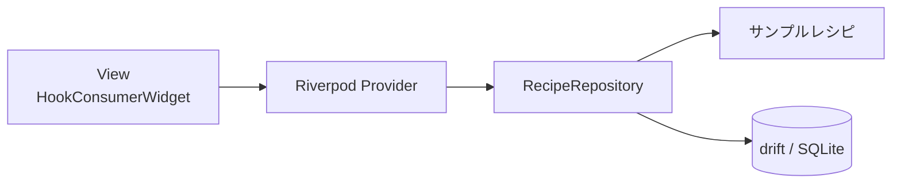

# recipe_search_app

レシピを検索・絞り込み・お気に入り登録し、カレンダーや栄養バランスで楽しむ Flutter 製のモバイルアプリです。レシピのマスタデータはアプリ内に同梱され、お気に入りのみ drift（SQLite）でローカルに永続化します。

## 主な機能

- 🔎 **レシピ一覧・検索** — タイトル／説明文からのキーワード検索とカテゴリ切り替え
- 🧰 **詳細な絞り込み** — 難易度・調理時間・カロリー・評価・アレルギー除外・タグ・材料（含む／除く）の複合フィルタ
- ⭐ **お気に入り** — drift（SQLite）でローカル保存、一覧から素早く再アクセス
- 📅 **カレンダー** — `table_calendar` で日付ごとのおすすめレシピを表示
- 📊 **栄養バランス** — `fl_chart` の円グラフで PFC（タンパク質・脂質・炭水化物）を可視化
- 📝 **レシピ詳細** — 材料・手順・栄養情報・コメントを表示

## スクリーンショット

> TODO: 実機／シミュレータのスクリーンショットを追加する。

| ホーム（一覧・検索） | 絞り込み | お気に入り | カレンダー | 詳細 |
|:---:|:---:|:---:|:---:|:---:|
| _TODO_ | _TODO_ | _TODO_ | _TODO_ | _TODO_ |

## 前提条件

| ツール | バージョン | 確認コマンド |
|--------|-----------|--------------|
| Flutter | 3.47.5 で動作確認 | `flutter --version` |
| Dart | 3.13.x（pubspec の `sdk: ^3.10.4` を満たすこと） | `dart --version` |
| iOS 開発 | Xcode（Mac のみ） | `xcodebuild -version` |
| Android 開発 | Android Studio / Android SDK | — |

環境が整っているかは `flutter doctor` で確認できます。

## クイックスタート

```bash
# 1. リポジトリを取得
git clone git@github.com:fumiyasac/recipe_search_app.git
cd recipe_search_app

# 2. 依存関係を解決
flutter pub get

# 3. コード生成（*.g.dart を生成）
dart run build_runner build --delete-conflicting-outputs

# 4. 実行（接続中のデバイス／シミュレータで起動）
flutter run
```

> `*.g.dart`（`providers.g.dart` / `database.g.dart`）は Git 管理されているため、クローン直後でもビルドは可能です。ソースを変更した際は手順 3 を再実行してください。

## 開発コマンド

```bash
# 依存解決
flutter pub get

# コード生成（1 回）
dart run build_runner build --delete-conflicting-outputs
# コード生成（監視モード）
dart run build_runner watch --delete-conflicting-outputs

# 静的解析
flutter analyze

# フォーマット（チェックのみ）
dart format --output=none --set-exit-if-changed lib/
# フォーマット（書き込み）
dart format lib/

# テスト
flutter test

# 実行
flutter run
```

## プロジェクト構成

```
recipe_search_app/
├── lib/
│   ├── main.dart                  # エントリポイント（ProviderScope / MaterialApp）
│   ├── models/                    # ドメイン・状態モデル（手書き）
│   │   ├── recipe.dart            # Recipe / RecipeStep / RecipeComment / NutritionInfo
│   │   └── filter_state.dart      # FilterState / IngredientFilter / 各種 enum
│   ├── database/                  # drift によるローカル永続化
│   │   ├── database.dart          # FavoriteRecipes テーブル / AppDatabase
│   │   └── database.g.dart        # 生成物（コミット対象）
│   ├── repositories/
│   │   └── recipe_repository.dart # サンプルレシピ + お気に入り DB の集約窓口
│   ├── viewmodels/                # Riverpod Provider 群
│   │   ├── providers.dart         # @riverpod 定義
│   │   └── providers.g.dart       # 生成物（コミット対象）
│   ├── views/                     # 画面 Widget（HookConsumerWidget）
│   │   ├── main_navigation_screen.dart
│   │   ├── recipe_list_screen.dart
│   │   ├── favorites_screen.dart
│   │   ├── calendar_screen.dart
│   │   └── recipe_detail_screen.dart
│   └── widgets/                   # 再利用 UI 部品
│       ├── recipe_card.dart
│       ├── filter_section.dart
│       ├── advanced_filter_sheet.dart
│       └── nutrition_chart.dart
├── test/
│   └── widget_test.dart           # ※ 現状はデフォルトのひな形（要差し替え）
├── android/ ios/                  # モバイル向けネイティブプロジェクト
├── linux/ macos/ windows/ web/    # Flutter 既定のひな形（本アプリでは未対応・動作確認なし）
├── analysis_options.yaml          # flutter_lints ベースの Lint 設定
└── pubspec.yaml
```

> `android/` と `ios/` が主なターゲットです。`linux/` `macos/` `windows/` `web/` は `flutter create` が生成した既定のひな形がコミットされているだけで、デスクトップ／Web 向けの実装・動作確認は行っていません。

## アーキテクチャ

MVVM + Repository パターンを採用し、状態管理は `@riverpod` でコード生成した Provider 群で行います。レイヤー構成図・Provider 依存関係図・ER 図・画面遷移図（いずれも Mermaid）は [architecture_guidance.md](./architecture_guidance.md) を参照してください。



## テスト

```bash
flutter test
```

> ⚠️ **既知の課題**: `test/widget_test.dart` は `flutter create` が生成したデフォルトのカウンターアプリ用テストのままで、本アプリには存在しないウィジェットを参照するため**現状このテストは失敗します**。Provider／Repository の単体テストや画面のウィジェットテストへの差し替えが必要です（[トラブルシューティング](#トラブルシューティング)参照）。

## トラブルシューティング

| 症状 | 対処 |
|------|------|
| `*.g.dart` が見つからない／Provider が未定義エラー | `dart run build_runner build --delete-conflicting-outputs` を実行 |
| 生成物の競合エラー | `--delete-conflicting-outputs` を付けて再生成（上記コマンド） |
| `flutter analyze` で deprecation 警告（Radio の `groupValue` / `onChanged`） | info レベルの既知警告。`RadioGroup` への移行が今後の課題 |
| `flutter test` が「Counter increments smoke test」で失敗する | デフォルトのひな形テストが原因。実アプリに即したテストへ差し替える |
| お気に入りの挙動がおかしい／DB を初期化したい | 端末のアプリデータを削除するとドキュメントディレクトリの `recipes.sqlite` が消え、初期状態に戻る |
| 依存解決に失敗する | Flutter / Dart のバージョンが[前提条件](#前提条件)を満たしているか `flutter doctor` で確認 |

## ドキュメント

- [CLAUDE.md](./CLAUDE.md) — AI エージェント／開発者向けの作業ガイド（技術スタック・コマンド・守るべきルール・コード生成トリガー）
- [architecture_guidance.md](./architecture_guidance.md) — 詳細なアーキテクチャ解説（レイヤー構成・Provider 依存・ER 図・画面遷移図）
