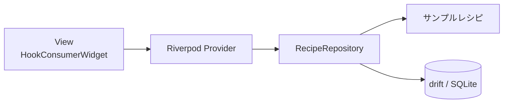

# recipe_search_app

[](https://github.com/fumiyasac/recipe_search_app/actions/workflows/ci.yml)

レシピを検索・絞り込み・お気に入り登録し、カレンダーや栄養バランスで楽しむ Flutter 製のモバイルアプリです。レシピのマスタデータはアプリ内に同梱され、お気に入りのみ drift（SQLite）でローカルに永続化します。

## 主な機能

- 🔎 **レシピ一覧・検索** — タイトル／説明文からのキーワード検索とカテゴリ切り替え
- 🧰 **詳細な絞り込み** — 難易度・調理時間・カロリー・評価・アレルギー除外・タグ・材料（含む／除く）の複合フィルタ
- ⭐ **お気に入り** — drift（SQLite）でローカル保存、一覧から素早く再アクセス
- 📅 **カレンダー** — `table_calendar` で日付ごとのおすすめレシピを表示
- 📊 **栄養バランス** — `fl_chart` の円グラフで PFC（タンパク質・脂質・炭水化物）を可視化
- 📝 **レシピ詳細** — 材料・手順・栄養情報・コメントを表示

## スクリーンショット

> TODO: 実機／シミュレータのスクリーンショットを追加する。

| ホーム（一覧・検索） | 絞り込み | お気に入り | カレンダー | 詳細 |
|:---:|:---:|:---:|:---:|:---:|
| _TODO_ | _TODO_ | _TODO_ | _TODO_ | _TODO_ |

## 前提条件

| ツール | バージョン | 確認コマンド |
|--------|-----------|--------------|
| Flutter | 3.47.5（`.mise.toml` で固定） | `flutter --version` |
| Dart | 3.13.x（pubspec の `sdk: ^3.10.4` を満たすこと） | `dart --version` |
| iOS 開発 | Xcode（Mac のみ） | `xcodebuild -version` |
| Android 開発 | Android Studio / Android SDK | — |
| mise（任意・推奨） | 最新 | `mise --version` |

環境が整っているかは `flutter doctor` で確認できます。

### mise によるツールバージョン管理（任意・推奨）

`.mise.toml` で Flutter のバージョン（3.47.5）を固定しています。[mise](https://mise.jdx.dev/) を導入すると、チーム・CI と同一バージョンの Flutter を自動で用意できます。

```bash
# mise のインストール（macOS / Homebrew の例）
brew install mise
# シェル連携（zsh の例。詳細は mise 公式ドキュメント参照）
echo 'eval "$(mise activate zsh)"' >> ~/.zshrc

# リポジトリルートで実行すると .mise.toml のバージョンが導入される
mise install
```

mise を使わない場合も、Flutter 3.47.5（stable）を手動で用意すれば動作します。

## クイックスタート

```bash
# 1. リポジトリを取得
git clone git@github.com:fumiyasac/recipe_search_app.git
cd recipe_search_app

# 2. ツールバージョンを導入（mise 利用時。未使用なら Flutter 3.47.5 を手動で用意）
mise install

# 3. Git フックを有効化（コミット時に dart format を自動実行）
sh scripts/setup-hooks.sh

# 4. 依存関係を解決
flutter pub get

# 5. コード生成（*.g.dart を生成）
dart run build_runner build --delete-conflicting-outputs

# 6. 実行（接続中のデバイス／シミュレータで起動）
flutter run
```

> `*.g.dart`（`providers.g.dart` / `database.g.dart`）は Git 管理されているため、クローン直後でもビルドは可能です。ソースを変更した際は手順 5 を再実行してください。

## 開発コマンド

```bash
# 依存解決
flutter pub get

# コード生成（1 回）
dart run build_runner build --delete-conflicting-outputs
# コード生成（監視モード）
dart run build_runner watch --delete-conflicting-outputs

# 静的解析
flutter analyze

# フォーマット（チェックのみ。CI と同じ全体チェック）
dart format --output=none --set-exit-if-changed .
# フォーマット（書き込み）
dart format .

# テスト
flutter test
# テスト（カバレッジ出力。coverage/lcov.info を生成）
flutter test --coverage

# 実行
flutter run

# ツールバージョンの導入（mise 利用時）
mise install
# Git フックの有効化（初回のみ）
sh scripts/setup-hooks.sh
```

## プロジェクト構成

```
recipe_search_app/
├── lib/
│   ├── main.dart                  # エントリポイント（ProviderScope / MaterialApp）
│   ├── models/                    # ドメイン・状態モデル（手書き）
│   │   ├── recipe.dart            # Recipe / RecipeStep / RecipeComment / NutritionInfo
│   │   └── filter_state.dart      # FilterState / IngredientFilter / 各種 enum
│   ├── database/                  # drift によるローカル永続化
│   │   ├── database.dart          # FavoriteRecipes テーブル / AppDatabase
│   │   └── database.g.dart        # 生成物（コミット対象）
│   ├── repositories/
│   │   └── recipe_repository.dart # サンプルレシピ + お気に入り DB の集約窓口
│   ├── viewmodels/                # Riverpod Provider 群
│   │   ├── providers.dart         # @riverpod 定義
│   │   └── providers.g.dart       # 生成物（コミット対象）
│   ├── views/                     # 画面 Widget（HookConsumerWidget）
│   │   ├── main_navigation_screen.dart
│   │   ├── recipe_list_screen.dart
│   │   ├── favorites_screen.dart
│   │   ├── calendar_screen.dart
│   │   └── recipe_detail_screen.dart
│   └── widgets/                   # 再利用 UI 部品
│       ├── recipe_card.dart
│       ├── filter_section.dart
│       ├── advanced_filter_sheet.dart
│       └── nutrition_chart.dart
├── test/
│   └── models/                    # モデルの単体テスト
│       ├── filter_state_test.dart
│       └── recipe_test.dart
├── .github/workflows/ci.yml       # GitHub Actions（品質ゲート）
├── .githooks/pre-commit           # コミット前に dart format を実行するフック
├── scripts/                       # setup-hooks.sh / claude_format_hook.sh
├── .claude/settings.json          # Claude Code の権限・フック設定
├── .mise.toml                     # Flutter バージョン固定
├── android/ ios/                  # モバイル向けネイティブプロジェクト
├── linux/ macos/ windows/ web/    # Flutter 既定のひな形（本アプリでは未対応・動作確認なし）
├── analysis_options.yaml          # flutter_lints ベースの Lint 設定
└── pubspec.yaml
```

> `android/` と `ios/` が主なターゲットです。`linux/` `macos/` `windows/` `web/` は `flutter create` が生成した既定のひな形がコミットされているだけで、デスクトップ／Web 向けの実装・動作確認は行っていません。

## アーキテクチャ

MVVM + Repository パターンを採用し、状態管理は `@riverpod` でコード生成した Provider 群で行います。レイヤー構成図・Provider 依存関係図・ER 図・画面遷移図（いずれも Mermaid）は [architecture_guidance.md](./architecture_guidance.md) を参照してください。



## テスト

```bash
# 全テスト実行
flutter test
# カバレッジ出力（coverage/lcov.info を生成）
flutter test --coverage
```

現在は `test/models/` にモデル（`FilterState` / `Recipe`）の単体テストを配置しています。Provider／Repository の単体テストや画面のウィジェットテストは今後拡充する余地があります。

## 品質ゲート（CI / Git フック）

| 仕組み | 内容 |
|--------|------|
| GitHub Actions（`.github/workflows/ci.yml`） | `main` への push と PR で、`flutter pub get` → フォーマットチェック → `flutter analyze` → 生成コードのコミット漏れ検出（build_runner + `git status`）→ `flutter test --coverage` を実行。カバレッジは Job Summary に出力。 |
| Git フック（`.githooks/pre-commit`） | コミット時にステージ済みの `.dart`（`*.g.dart` を除く）へ `dart format` を自動適用。`sh scripts/setup-hooks.sh` で有効化。 |
| Claude Code 設定（`.claude/settings.json`） | flutter / dart / git の読み取り系コマンドと build_runner を許可、`git push --force` や `rm -rf` を禁止。Edit/Write 後に変更 `.dart` を自動整形する PostToolUse フックを設定。 |

CI と同じチェックはローカルでも実行できます。

```bash
dart format --output=none --set-exit-if-changed .
flutter analyze
dart run build_runner build --delete-conflicting-outputs && git status --porcelain
flutter test --coverage
```

## トラブルシューティング

| 症状 | 対処 |
|------|------|
| `*.g.dart` が見つからない／Provider が未定義エラー | `dart run build_runner build --delete-conflicting-outputs` を実行 |
| 生成物の競合エラー | `--delete-conflicting-outputs` を付けて再生成（上記コマンド） |
| CI の「Format check」で失敗する | ローカルで `dart format .` を実行して差分をコミット（フック有効化で自動化できる） |
| CI の「Verify generated code is committed」で失敗する | build_runner を実行し、生成された `*.g.dart` をコミット |
| pre-commit フックが動かない | `sh scripts/setup-hooks.sh` を実行して `core.hooksPath` を設定したか確認 |
| お気に入りの挙動がおかしい／DB を初期化したい | 端末のアプリデータを削除するとドキュメントディレクトリの `recipes.sqlite` が消え、初期状態に戻る |
| 依存解決に失敗する | Flutter / Dart のバージョンが[前提条件](#前提条件)を満たしているか `flutter doctor` で確認 |

## Claude Code の Skill / Subagent

本リポジトリには開発を補助する Claude Code の Skill（`/codegen` `/add-feature` `/drift-schema-change` `/add-provider-test` `/doc-sync`）と Subagent（`code-reviewer` / `test-writer` / `impact-analyzer`）を同梱しています。一覧・呼び出し例・連携フローは [skill_guidance.md](./skill_guidance.md) を参照してください。

## ドキュメント

- [CLAUDE.md](./CLAUDE.md) — AI エージェント／開発者向けの作業ガイド（技術スタック・コマンド・守るべきルール・コード生成トリガー）
- [architecture_guidance.md](./architecture_guidance.md) — 詳細なアーキテクチャ解説（レイヤー構成・Provider 依存・ER 図・画面遷移図）
- [skill_guidance.md](./skill_guidance.md) — Claude Code の Skill / Subagent 一覧と連携フロー
