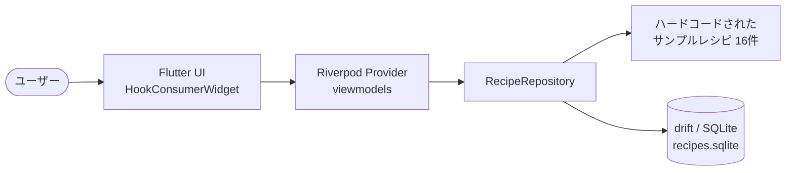
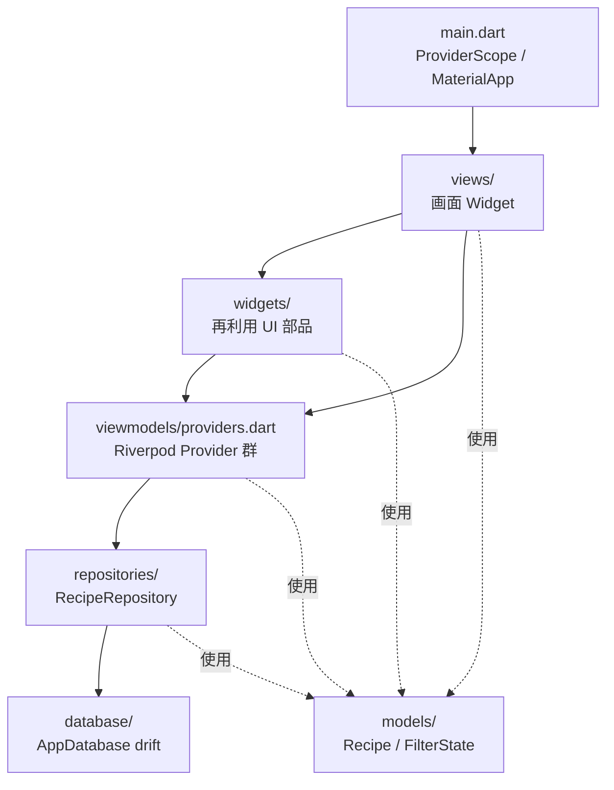
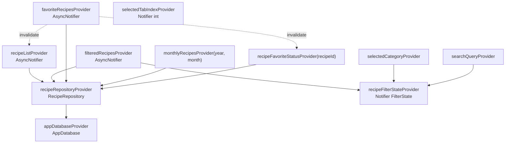
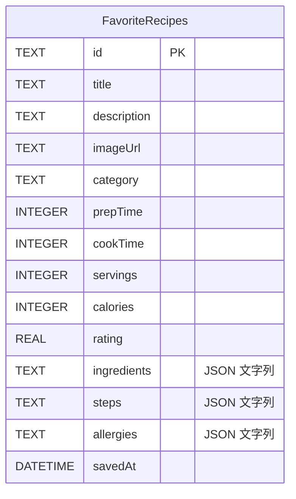
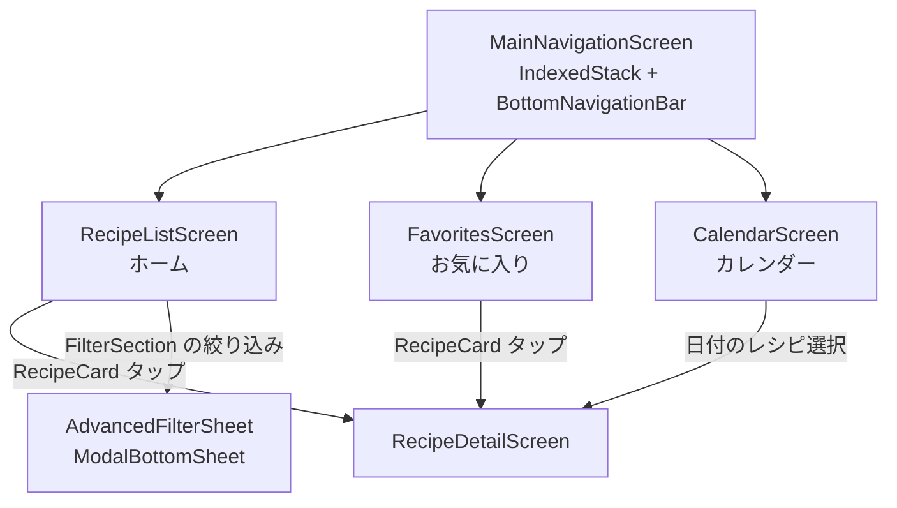

# アーキテクチャガイド

recipe_search_app の内部構造を図とともに解説します。概要・ルールは [CLAUDE.md](./CLAUDE.md)、セットアップは [README.md](./README.md) を参照してください。

## 目次

1. [システム全体像](#1-システム全体像)
2. [レイヤー構成](#2-レイヤー構成)
3. [状態管理（Riverpod）](#3-状態管理riverpod)
4. [データベース（drift）](#4-データベースdrift)
5. [画面遷移](#5-画面遷移)
6. [新機能を追加する際の標準手順](#6-新機能を追加する際の標準手順)

---

## 1. システム全体像

単一の Flutter モバイルアプリです。バックエンド／ネットワーク通信はなく、レシピのマスタデータは `RecipeRepository` 内にハードコードされています。永続化するのはお気に入り情報のみで、drift（SQLite）でローカル保存します。

---

## 2. レイヤー構成

MVVM + Repository パターンを `lib/` 配下のフォルダで表現しています。依存は上位（UI）から下位（データ）への一方向です。

### ディレクトリと責務

| パス | 責務 | 主な中身 |
|------|------|----------|
| `lib/main.dart` | エントリポイント | `ProviderScope`、`MaterialApp`（Material 3、シードカラー `#FF6B35`）、`home: MainNavigationScreen` |
| `lib/models/` | ドメイン／状態モデル（手書き、freezed 未使用） | `recipe.dart`（`Recipe` / `RecipeStep` / `RecipeComment` / `NutritionInfo`）、`filter_state.dart`（`FilterState` / `IngredientFilter` / `CookingTimeRange` / `CalorieRange`） |
| `lib/database/` | drift による永続化 | `FavoriteRecipes` テーブル、`AppDatabase`、生成物 `database.g.dart` |
| `lib/repositories/` | データソースの集約窓口 | `RecipeRepository`（サンプルレシピ + お気に入り DB の橋渡し、絞り込み・検索ヘルパー） |
| `lib/viewmodels/` | 状態管理 | `providers.dart`（`@riverpod` 定義）、生成物 `providers.g.dart` |
| `lib/views/` | 画面 | `main_navigation_screen` / `recipe_list_screen` / `favorites_screen` / `calendar_screen` / `recipe_detail_screen` |
| `lib/widgets/` | 再利用部品 | `recipe_card` / `filter_section` / `advanced_filter_sheet` / `nutrition_chart` |

- `nutrition_chart.dart` のみ `StatelessWidget`、それ以外の View / Widget はすべて `HookConsumerWidget`。
- `table_calendar` は `calendar_screen.dart` でのみ使用。
- `fl_chart`（`PieChart`）は `nutrition_chart.dart` でのみ使用（PFC バランスの円グラフ）。

---

## 3. 状態管理（Riverpod）

すべての Provider は `riverpod_annotation` の `@riverpod` アノテーションでコード生成しています（`providers.g.dart`）。手書き Provider は使用していません。

- **関数プロバイダー**: `appDatabase` / `recipeRepository`（インスタンスを提供）
- **同期 Notifier**: `RecipeFilterState`（`FilterState`）、`SelectedCategory`、`SearchQuery`、`SelectedTabIndex`
- **非同期 AsyncNotifier（`Future` を `build`）**: `RecipeList`、`FilteredRecipes`、`FavoriteRecipes`、`MonthlyRecipes`（family: year, month）、`RecipeFavoriteStatus`（family: recipeId）
- UI 側は `HookConsumerWidget` で `ref.watch` し、`useState` / `useTextEditingController` などの Hooks でローカル状態を扱う。

> `FavoriteRecipes.toggleFavorite()` は、お気に入りの追加／削除後に `recipeListProvider` と該当 `recipeFavoriteStatusProvider(id)` を `invalidate` し、自身の `state` を再構築することで画面間の整合性を保ちます。

---

## 4. データベース（drift）

`AppDatabase` は `FavoriteRecipes` の 1 テーブルのみを持ちます。DAO クラスは分離せず、クエリメソッドを `AppDatabase` に直接定義しています。DB ファイルは `path_provider` で取得したアプリのドキュメントディレクトリ配下の `recipes.sqlite`（`NativeDatabase` / `LazyDatabase`）です。

- `schemaVersion = 1`。**`MigrationStrategy`（`onUpgrade`）は未定義**で、drift の既定動作に依存しています。
- `ingredients` / `steps` / `allergies` は `jsonEncode` した JSON 文字列として単一カラムに格納（正規化していない）。
- レシピのマスタデータは DB に入っておらず、`RecipeRepository._getAllRecipes()` のハードコードが真実の源。DB はお気に入りの id 集合＋表示用スナップショットのみ保持します。

> ⚠️ テーブルを変更する際は、必ず `schemaVersion` を上げ、`MigrationStrategy` を実装してください（[CLAUDE.md](./CLAUDE.md) の「守るべきルール」参照）。現状は未整備のため、スキーマ変更時の既存データ移行が課題です。

---

## 5. 画面遷移

ボトムナビゲーション（3 タブ）を `IndexedStack` で保持し、詳細画面へは `Navigator.push`（`MaterialPageRoute`）で遷移します。名前付きルーティング（go_router 等）は未導入です。

---

## 6. 新機能を追加する際の標準手順

1. **モデル** — 必要なら `lib/models/` にクラスを追加／拡張する（手書き、`copyWith` の慣習に合わせる）。
2. **永続化が必要な場合** — `lib/database/database.dart` のテーブルを変更し、`schemaVersion` を上げて `MigrationStrategy` を実装 → `dart run build_runner build --delete-conflicting-outputs`。
3. **データアクセス** — `RecipeRepository` にメソッドを追加する（View / Provider から DB を直接触らない）。
4. **状態管理** — `lib/viewmodels/providers.dart` に `@riverpod` で Provider / Notifier / AsyncNotifier を追加 → コード生成を実行し `providers.g.dart` をコミット。
5. **UI** — 画面は `lib/views/`、再利用部品は `lib/widgets/` に `HookConsumerWidget` で追加。`ref.watch` で状態を購読し、ローカル状態は Hooks で扱う。
6. **画面遷移** — 既存の `Navigator.push`（`MaterialPageRoute`）の慣習に合わせる。
7. **検証** — `flutter analyze` / `dart format` / `flutter test` を実行。生成物を含めてコミットする。
