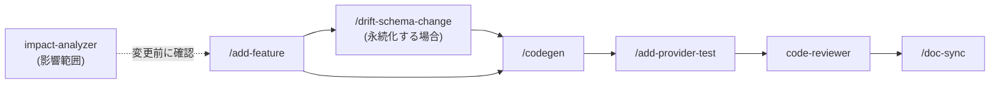

# Skill & Subagent ガイド

recipe_search_app に導入した Claude Code の **Skill**（`.claude/skills/<name>/SKILL.md`）と
**Subagent**（`.claude/agents/<name>.md`）の一覧・使い方・連携フローをまとめます。
前提知識は [CLAUDE.md](./CLAUDE.md) と [architecture_guidance.md](./architecture_guidance.md) を参照してください。

本リポジトリは drift（ローカル SQLite）中心の単一 Flutter パッケージのため、
参考実装（travel_booking）にあった GraphQL／バックエンド系スキルは持ちません。

## Skills 一覧

| スキル | 呼び出し | 概要 | 自動起動 |
|--------|----------|------|:--------:|
| [`/codegen`](.claude/skills/codegen/SKILL.md) | `/codegen` または自然言語 | build_runner を実行し、生成エラーを特定・修正する | ✓ |
| [`/add-feature`](.claude/skills/add-feature/SKILL.md) | `/add-feature <機能名>` または自然言語 | 既存の層構成に沿って モデル→(DB)→Repository→Provider→Screen の雛形を生成 | ✓ |
| [`/drift-schema-change`](.claude/skills/drift-schema-change/SKILL.md) | `/drift-schema-change <変更内容>` または自然言語 | **最重要。** テーブル変更→schemaVersion++→onUpgrade→schema dump→マイグレーションテスト→codegen を一貫実行（書き込み前に確認。`--dry-run` あり） | ✓ |
| [`/add-provider-test`](.claude/skills/add-provider-test/SKILL.md) | `/add-provider-test <Provider名>` または自然言語 | ProviderContainer + `NativeDatabase.memory()` で Provider テストを生成 | ✓ |
| [`/doc-sync`](.claude/skills/doc-sync/SKILL.md) | `/doc-sync [--check\|--fix]` または自然言語 | コードと CLAUDE.md / README / architecture_guidance.md の乖離を検出・修正（`context: fork`） | ✓ |

すべて description のトリガー文で自動起動し得ます。`/drift-schema-change` はスキーマを書き換えるため、
実行前に変更内容を要約して確認します（`--dry-run` で手順のみ出力）。`/doc-sync` は `context: fork` で
独立実行し、本会話のコンテキストを汚しません。

## Subagents 一覧

| エージェント | tools | 役割 | 権限 |
|--------------|-------|------|------|
| [`code-reviewer`](.claude/agents/code-reviewer.md) | Read, Grep, Glob, Bash | 差分をレビューし、Riverpod のアンチパターン（**リソース保持 Provider のライフサイクル=keepAlive+ref.onDispose** / build 内副作用 / ビジネスロジックの直書き / ref.read・watch 誤用）と drift の誤用（重いクエリ / トランザクション漏れ / DB の close 漏れ）を指摘 | 読み取り専用 |
| [`test-writer`](.claude/agents/test-writer.md) | Read, Grep, Glob, Edit, Write, Bash | 指定ファイルのテストを作成し `flutter test` が通るまで修正 | 書き込み可 |
| [`impact-analyzer`](.claude/agents/impact-analyzer.md) | Read, Grep, Glob | 変更対象を参照している箇所を洗い出し、影響範囲レポートを返す | 読み取り専用 |

### 使い分け

- **変更の前に** → `impact-analyzer` で影響範囲を把握（読み取り専用・安全）。
- **テストを増やしたい** → `test-writer`（実際にファイルを作り、緑になるまで反復）。Provider テストの型は `/add-provider-test` スキルと同じ。
- **コミット前の最終確認** → `code-reviewer`（Riverpod/drift 特化の静的レビュー。コードは変更しない）。

> Skill と Subagent の違い: Skill は「決まった手順」を実行するための手順書、Subagent は
> 独立したツール権限を持つ補助エージェント。`test-writer`（Subagent）は `/add-provider-test`（Skill）の
> 手順を内部で踏襲します。

## スキル連携フロー



- 典型的な新機能追加は左から右へ。永続化が絡むときだけ `/drift-schema-change` を経由する。
- 仕上げに `code-reviewer` でレビューし、`/doc-sync` でドキュメントを同期する。

## 代表的な呼び出し例

```
# 新機能（お気に入りメモ）を追加し、DB 変更を安全に行う
/add-feature recipe_memo
/drift-schema-change FavoriteRecipes に memo カラムを追加
/codegen
/add-provider-test FavoriteRecipes

# 変更前の影響調査（読み取り専用）
impact-analyzer: lib/database/database.dart の FavoriteRecipes を変更したい

# コミット前のレビューとドキュメント同期
code-reviewer: 現在の差分をレビューして
/doc-sync --check
```

## 新しい Skill / Subagent を追加するときのチェックリスト

1. Skill は `.claude/skills/<name>/SKILL.md`、Subagent は `.claude/agents/<name>.md` に置く。
2. frontmatter に `name` / `description`（トリガー文を含める）を書く。Skill は手順・完了条件・失敗時の対処を本文に、Subagent は `tools` を必要最小限で指定する。
3. 本ガイドの一覧表・連携フロー（必要なら Mermaid）に追記する。
4. README / CLAUDE.md の導線が本ガイドを指していることを確認する（`/doc-sync` で点検可能）。
